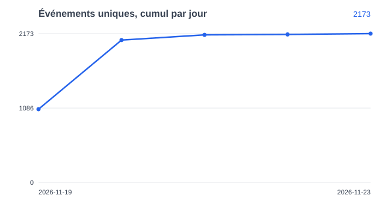
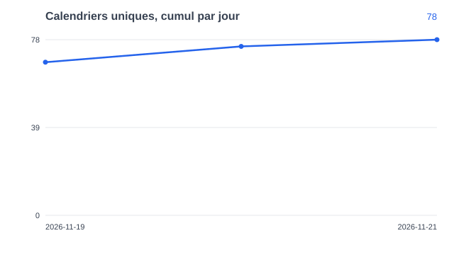

# Luma Event Scraper

<p align="center">
  
  
</p>

Scraper quotidien des événements **tech** et **IA** publiés sur [Luma](https://lu.ma), configuré pour Paris. Il interroge l'endpoint de découverte de Luma, dédoublonne par `api_id` et produit des CSV avec les nouveaux événements.

> Basé sur [mayckolco/luma-event-scraper](https://github.com/mayckolco/luma-event-scraper).

## Prérequis

- Python 3.10+
- Aucune dépendance externe (stdlib uniquement)

## Utilisation

```bash
# Exécution complète : scrape et sauvegarde
python src/scraper.py

# Vérifier la connexion et le parsing, sans rien écrire
python src/scraper.py --dry-run
```

## Structure

```
src/                # Code source (scraper, config, calendriers, graphiques)
data/               # Données et état (CSV, index de déduplication)
  new_events/       # Un CSV par jour : nouveaux événements
docs/               # Spécification, roadmap, périmètre, tableau de bord
tests/              # Tests unitaires (sans réseau)
charts/             # Graphiques SVG générés
.github/workflows/  # Automatisation planifiée
```

## Fichiers de données (`data/`)

| Fichier | Contenu |
|---|---|
| `data/seen_events.json` | Index de déduplication (`api_id` → `first_seen`) |
| `data/events_master.csv` | Historique cumulé de tous les événements détectés |
| `data/new_events/new_events_<YYYY-MM-DD>.csv` | Seulement les nouveaux événements du jour |
| `data/calendar_master.csv` | Calendriers Luma connus (`nom`, `url`, `calendar_api_id`, `backfilled`), cumulés |
| `data/stats_daily.csv` | Une ligne par jour : totaux uniques d'événements et de calendriers |
| `charts/*.svg` | Graphiques des totaux cumulés, générés depuis `data/stats_daily.csv` |

Champs de `events_master.csv` : `name`, `url`, `start_date`, `city`, `category`, `organisateur`, `first_seen`, puis `speaker_1` à `speaker_10` avec leur lien (`speaker_N_lien`) et info (`info_speaker_N`).

## Calendriers et graphiques (`src/daily_update.py`)

- Interroge discover, ne réinterroge jamais un calendrier déjà connu.
- Backfille chaque **nouveau** calendrier (passé et futur, 2 requêtes) et ne l'enregistre qu'en cas de succès.
- Ajoute une ligne à `data/stats_daily.csv` et régénère les graphiques.
- Sans `--write`, ne fait que la découverte et affiche les nouveaux calendriers.

```bash
python src/daily_update.py            # aperçu : discover seulement
python src/daily_update.py --write    # backfill des nouveaux + stats + graphiques
python src/backfill_calendar.py --calendar-api-id cal-xxxx --write   # un calendrier à la main
```

Les graphiques apparaissent après le premier run de `src/daily_update.py --write`.

## Configuration

Modifier [`src/config.py`](src/config.py), sans toucher à la logique du scraper :

- `CATEGORIES` : slugs interrogés (par défaut `tech`, `ai`)
- `CITIES` : liste de `{name, lat, lon}` (au moins une ville)
- `MAX_PAGES` : limite de sécurité par couple catégorie/ville
- `REQUEST_DELAY_MIN` / `REQUEST_DELAY_MAX` : pause aléatoire entre les requêtes
- `MAX_RETRIES` / `RETRY_BACKOFF_BASE` : nouvelles tentatives en cas d'erreur réseau

## Automatisation (GitHub Actions)

Le workflow [`.github/workflows/scrape.yml`](.github/workflows/scrape.yml) lance le scraper :

- **Planifié** : `0 8 * * *` (chaque jour à 08:00 UTC)
- **Manuel** : Actions → Daily Luma Scrape → Run workflow
- **Sur push/PR** : le job `validate` lance `--dry-run`

Après chaque run planifié, le workflow commite `data/` dans le dépôt.

## Maintenance

- **Changer villes ou catégories** : modifier `src/config.py`, lancer `python src/scraper.py --dry-run`, la run suivante utilisera la nouvelle config.
- **Si l'endpoint Luma change** : consulter le compteur `Avertissements de schéma` dans le résumé de run, inspecter le payload brut signalé par `extract_entries`, puis adapter `parse_entry()` dans `src/scraper.py`.

## Documentation du projet

- [docs/prd.md](docs/prd.md) : spécification produit
- [docs/roadmap.md](docs/roadmap.md) : plan de développement et avancement
- [docs/alcance.html](docs/alcance.html) : vue visuelle du périmètre
- [docs/dashboard.html](docs/dashboard.html) : tableau de bord interactif des événements (à ouvrir via `python -m http.server 8000` à la racine, puis `http://localhost:8000/docs/dashboard.html`)
