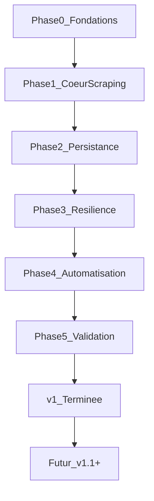

# Roadmap — Luma Event Scraper

**Créé le :** 11 juillet 2026  
**Dernière mise à jour :** 11 juillet 2026 (v1 terminée)  
**Spécification de référence :** [prd.md](prd.md)

---

## Objet

Ce document est le **guide opérationnel du projet**. Il traduit le [PRD](prd.md) en un plan de développement séquentiel avec des éléments suivables. Il est mis à jour au fil de l'avancement : on marque la progression ici, pas dans le PRD.

### Convention de statuts

| Symbole | Statut |
|---|---|
| `[ ]` | À faire |
| `[~]` | En cours |
| `[x]` | Terminé |

Chaque élément référence son exigence du PRD (`RF-x` ou `RNF-x`) lorsque c'est pertinent.

---

## Vision et objectif v1

**Objectif :** Automatiser la détection quotidienne des nouveaux événements tech/IA sur Luma (lu.ma), sans API officielle ni intervention manuelle.

**Métriques de succès (PRD §9) :**

| Métrique | Objectif |
|---|---|
| Nouveaux événements détectés par semaine | > 0 de façon régulière |
| Taux d'erreur des exécutions (échecs non récupérés) | < 5 % |
| Faux doublons (événement signalé comme nouveau plus d'une fois) | 0 |
| Couverture géographique | ≥ 5 villes/régions par exécution |

---

## Enchaînement des phases



---

## Phase 0 — Fondations du projet

> Dépendances : aucune. Point de départ du dépôt.

- [x] **RNF-4** Créer la structure de base : `src/scraper.py`, `src/config.py`, `.gitignore` (fichiers d'état exclus du dépôt)
- [x] **RF-10** Définir la configuration externe dans `src/config.py` : catégories `["tech", "ai"]` et ≥ 5 villes avec `{name, lat, lon}`
- [x] **CLI** Implémenter le point d'entrée : `python src/scraper.py` et l'option `--dry-run` (sans écrire de fichiers de sortie)

**Livrables :** `src/scraper.py`, `src/config.py`, `.gitignore`

---

## Phase 1 — Cœur du scraping

> Dépendances : Phase 0 terminée.

- [x] **RF-1, RNF-1** Client HTTP vers l'endpoint `api.luma.com/discover/get-paginated-events` pour chaque couple `(catégorie, ville)`
- [x] **RF-2** Pagination automatique avec `pagination_cursor` jusqu'à épuisement des résultats ou limite de sécurité de pages
- [x] **RF-5, RNF-6** Parsing des événements : extraire `api_id`, `name`, `url`, `start_date` + contexte (`city`, `category`)

**Livrables :** logique de requête et de parsing fonctionnelle dans `src/scraper.py`

---

## Phase 2 — Persistance et déduplication

> Dépendances : Phase 1 terminée.

- [x] **RF-3, RF-4** Index de déduplication dans `data/seen_events.json`, indexé par `api_id`, persisté entre les exécutions
- [x] **RF-5** Générer `data/new_events/new_events_<AAAA-MM-JJ>.csv` avec les champs minimaux : `name`, `url`, `start_date`, `city`, `category`, `first_seen`
- [x] **RF-6** Tenir `data/events_master.csv` comme historique append-only de tous les événements détectés

**Livrables :** `data/seen_events.json`, `data/events_master.csv`, `data/new_events/new_events_<date>.csv`

---

## Phase 3 — Résilience et observabilité

> Dépendances : Phase 2 terminée.

- [x] **RF-8** Relances automatiques avec backoff exponentiel en cas de pannes réseau passagères
- [x] **RNF-2** Pauses aléatoires entre les requêtes ; pas de concurrence agressive
- [x] **RNF-3** Tolérance aux changements de schéma : échec de parsing d'un champ → log + continuer ; log des payloads inattendus
- [x] **RF-9** Journalisation de chaque exécution : événements consultés, nouveaux événements, erreurs rencontrées

**Livrables :** gestion d'erreurs robuste et logs structurés par exécution

---

## Phase 4 — Automatisation et déploiement

> Dépendances : Phase 3 terminée.

- [x] **RF-7** Workflow GitHub Actions dans `.github/workflows/scrape.yml` avec `cron: '0 8 * * *'`
- [x] **RF-4, RF-7** Persistance de l'état en CI : commit de `data/` (index et CSV), ou cache/artifact dans Actions
- [x] **CLI** Valider le mode `--dry-run` : connectivité à l'endpoint sans écrire de fichiers de sortie

**Livrables :** `.github/workflows/scrape.yml`, pipeline planifié fonctionnel

---

## Phase 5 — Validation de la v1

> Dépendances : Phase 4 terminée.

- [x] **Métriques §9** Exécution complète en local : pipeline complet sans erreur non récupérée
- [x] **Métriques §9** Vérifier la déduplication : une seconde exécution consécutive ne signale aucun doublon comme nouveau
- [x] **RF-10, Métriques §9** Vérifier la couverture : ≥ 5 villes interrogées par exécution
- [x] **Docs** Documenter les commandes d'usage et de maintenance (README ou section de cette roadmap)

**Critère de fin :** v1 prête pour une exploitation quotidienne en production. **Validée le 11 juillet 2026.**

### Résultats de validation

| Test | Résultat |
|---|---|
| Exécution complète | 12/12 combinaisons, 1386 événements, 0 erreur |
| Déduplication (2e exécution) | 0 nouveau événement en double |
| Couverture géographique | 6 villes interrogées |
| Documentation | [README.md](../README.md) |

---

## État actuel du projet

| Phase | Statut | Progression |
|---|---|---|
| Phase 0 — Fondations | Terminée | 3/3 |
| Phase 1 — Cœur du scraping | Terminée | 3/3 |
| Phase 2 — Persistance | Terminée | 3/3 |
| Phase 3 — Résilience | Terminée | 4/4 |
| Phase 4 — Automatisation | Terminée | 3/3 |
| Phase 5 — Validation | Terminée | 4/4 |
| **v1 terminée** | **Terminée** | **20/20 éléments** |

---

## Feuille de route future (après v1)

> Tous les éléments suivants nécessitent une **v1 terminée**.

### v1.1 — Notifications
- [ ] Alertes automatiques (Slack / Telegram / e-mail) lorsque de nouveaux événements sont détectés dans `data/new_events/new_events_<date>.csv`

### v1.2 — Filtrage
- [ ] Filtrage par mots-clés dans le nom ou la description de l'événement

### v2 — Enrichissement et visualisation
- [ ] Enrichissement avec les données des hôtes (réseaux sociaux) pour la génération de leads
- [ ] Dashboard web simple pour visualiser l'historique des événements

---

## Questions ouvertes

Décisions en suspens issues du [PRD §12](prd.md) pouvant affecter la configuration ou le périmètre :

1. **Usage prévu :** personnel / recherche, ou finalité commerciale (génération de leads, revente de données) ? Détermine le niveau de vérification des Conditions d'utilisation de Luma.
2. **Couverture géographique :** mondiale ou villes précises (ex. Lima + principaux hubs tech) ? Affecte la liste dans `src/config.py`.
3. **Alertes :** temps réel, ou le rapport quotidien cumulé suffit-il ? Affecte la priorité de la v1.1.

---

## Comment maintenir ce document

1. **Au début d'un élément :** passer `[ ]` → `[~]`
2. **À la fin d'un élément :** passer `[~]` → `[x]` et mettre à jour le tableau « État actuel du projet »
3. **À la clôture d'une phase :** vérifier que tous ses éléments sont `[x]` avant de passer à la suivante
4. **Toujours :** mettre à jour la date de « Dernière mise à jour » lors de la modification de ce fichier
5. **Ne pas dupliquer le PRD :** la roadmap est opérationnelle ; les changements de spécification vont dans [prd.md](prd.md)

### Commandes attendues (référence)

```bash
python src/scraper.py           # exécuter un run complet
python src/scraper.py --dry-run # valider la connectivité sans écrire de fichiers
```
